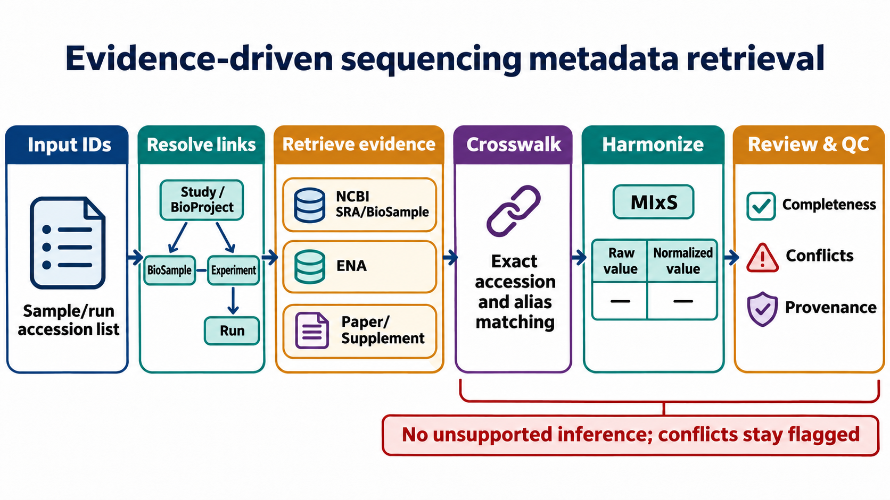

# Literature & methods review：公共测序样本 Metadata 获取与审计

**检索日期：** 2026-11-10  
**检索性质：** 为当前项目制定策略的聚焦方法检索，不是 PRISMA 系统综述；未对任何新测试样本发起数据库查询。检索范围包括 PubMed、NCBI 官方文档、ENA 官方文档、GSC MIxS 官方规范及期刊原文。

## 检索问题与方法

**问题：** 怎样把公开测序样本的 accession、BioSample/SRA/ENA 信息、文章与补充表中的生物学上下文，整理成一套可追溯、可复核、便于后续分析的数据？

**代表性检索词：**

- `MIxS MIMARKS microbial sample metadata standards`
- `BioSample metadata quality SRA sample-specific metadata normalization`
- `public microbiome sample metadata harmonization SRA ENA`
- `NCBI SRA Metadata and Submission Overview`
- `NCBI BioSample attributes E-utilities`
- `ENA Portal API advanced search returnFields`

聚焦纳入：公共测序归档对象模型和 API 文档、微生物组元数据标准、SRA/BioSample 元数据质量研究、已发表的样本级微生物组 metadata 规范化数据库方法。对非人/空间/多 assay 任务，不把 human-only 资源当作唯一数据源。

## 官方对象模型与接口

- **NCBI SRA** 将 STUDY（关联 BioProject）、SAMPLE（关联 BioSample）、EXPERIMENT 和 RUN 分开建模。Experiment 保存 library/instrument 等测序设置信息，Run 关联该 experiment 和实际数据文件；同一个 Sample 可以被多个 Study 共享。因此 run 不是独立生物样本，run-to-sample 必须通过 accession 关系核实。见 [NCBI SRA Metadata and Submission Overview](https://www.ncbi.nlm.nih.gov/sra/docs/submitmeta/)。
- **BioSample** 以 attribute name/value 描述生物材料，存在标准属性字典，也允许 submitter 提供自定义属性。字段名应按 raw name 原样留存，再映射到统一字段；不应先丢弃未知属性。见 [NCBI BioSample Attributes](https://www.ncbi.nlm.nih.gov/biosample/docs/attributes/)。
- **ENA Portal API** 可按 result type 查询并通过 `returnFields` 获取可返回字段；不同 result type 的字段集合不同。`read_run` 适合获取 run/sample/study/accession 与测序技术字段，必要时再查询 `sample`、`read_experiment`、`read_study` 或 XML。见 [ENA advanced search documentation](https://ena-docs.readthedocs.io/en/latest/retrieval/programmatic-access/advanced-search.html) 和 [ENA returnFields API](https://www.ebi.ac.uk/ena/portal/api/returnFields?result=read_run)。
- **NCBI E-utilities** 支持 ESearch/EFetch 等可编程检索；NCBI 文档规定默认请求速率限制，并建议批处理和使用 API key 时遵循相应限速。见 [E-utilities Introduction](https://www.ncbi.nlm.nih.gov/books/NBK25497/)。

## 标准和方法证据

1. **MIxS / MIMARKS**：Yilmaz et al. 提出 marker-gene 与任意序列的 minimum-information 规范，强调样本来源上下文及环境扩展。当前 GSC 规范继续提供 metagenome、marker sequence、HumanGut、HumanAssociated 等 checklist/extensions。新项目可以将 MIxS 作为字段组织和完整性参照，而不是要求旧归档必须完整符合该 checklist。见 [Yilmaz et al., 2011](https://pubmed.ncbi.nlm.nih.gov/21552244/) 和 [GSC MIxS current specification](https://genomicsstandardsconsortium.github.io/mixs/)。
2. **SRA 元数据规范化**：MetaSRA 指出 SRA/BioSample 元数据中自由文本、字段名同义词和非标准值会阻碍聚合分析；研究通过分类/规范化将样本描述整理成更可查询的 metadata。对新项目的启示是“原值与规范化值并列、标记推断/置信度/来源”，而不是只交付一份无 provenance 的干净宽表。见 [MetaSRA](https://academic.oup.com/bioinformatics/article/33/18/2914/3848915)。
3. **跨数据库元数据质量**：Gonçalves & Musen 分析 NCBI 与 EBI 数百万条样本 metadata，发现同一概念存在多种属性名和值、数据库间记录也可能不完全一致；HumanMetagenomeDB 的实现则展示了属性同义词整理、样本部位/疾病术语规范化和日期/单位统一的工作流。这支持按字段做受控词表映射，同时保留 submitter 原文。见 [The variable quality of metadata about biological samples](https://pmc.ncbi.nlm.nih.gov/articles/6380228/) 与 [HumanMetagenomeDB](https://academic.oup.com/nar/article/49/D1/D743/5998395)。
4. **近期微生物组数据库实践**：PRIME（NAR Database Issue, 2025）收集并人工整理 111 个公开人类 16S 项目、53,449 个样本，统一 phenotype/body-site/protocol 等 sample-level metadata；它可作为人类 16S 的二级交叉核验资源，但不是其他物种、shotgun 或空间样本的替代主档。见 [PRIME](https://pubmed.ncbi.nlm.nih.gov/41171140/)。
5. **完整性分级**：Kim et al. 2025 提出按 tier 评估微生物组 sequence 与 metadata sharing，并对 2,929 篇 human-gut 研究做分析；结果显示缺少可复用数据与 metadata 标准化不足仍常见。新任务宜先定义一组最低可用字段，再列扩展字段和研究特有字段，按队列汇总覆盖率。见 [Tier-based standards for FAIR sequence data and metadata sharing](https://pubmed.ncbi.nlm.nih.gov/40823805/)。
6. **治理原则**：FAIR 原则强调数据可发现、可访问、可互操作、可复用，适合落到 stable accession、来源链接、可读字段标准、原始证据、查询时间和可复跑记录上。见 [Wilkinson et al., 2016](https://www.nature.com/articles/sdata201618)。

## 当前建议的证据策略

元数据来源没有适用于所有字段的单一总排序，应按字段职责确定来源：

| 信息类型 | 优先来源 | 复核方式 |
|---|---|---|
| BioProject/Study、BioSample/Sample、Experiment、Run 的 accession 关系 | NCBI SRA/BioSample + ENA | accession exact-match、二级 accession、共享 sample 和一对多关系核验 |
| 平台、仪器型号、library strategy/source/selection/layout、read/base count、文件 URL/大小/MD5 | ENA/SRA experiment/run | 同一 run 的 ENA、SRA 字段交叉比对；记录检索时间和原始响应 |
| 样本 material、宿主、body site、年龄/性别/疾病等 repository attributes | BioSample/ENA sample | 保存完整 attribute 名和值；按 MIxS/受控词表规范化并保留 raw value |
| treatment/control、timepoint、subject/sample crosswalk、采集和实验 protocol | 文章全文、补充表、作者公开样本表 | 只接受直接 sample/run/alias 关联的证据；study-level 描述不能自动下推到样本 |
| 公开微生物组 curated database 的标签 | PRIME、HumanMetagenomeDB 等（适用时） | 只作二级交叉验证，记录资源版本，不覆盖原始仓库和论文证据 |

## 建议的获取和产出结构

### 1. 先解析实体，再谈“每个样本一行”

建议把用户原始输入作为 `input_item_id` 保留，并分开维护：

- **input manifest**：原始 sample ID/accession、用户给定的 accession 类型和其他已知上下文。
- **sample master**：一行一个 BioSample/ENA Sample 或经论文核验的生物学样本。
- **experiment table**：一行一个 experiment/library。
- **run table**：一行一个 run，保存平台、layout、reads/bases、file metadata 等。
- **crosswalk/evidence ledger**：输入 ID → repository accession → sample/experiment/run/subject 的每条映射及其来源、匹配方式、字段级原值/规范化值/状态。
- 如需分析方便，可另导出 sample×run 的扁平表；不把扁平表当成主事实表。

### 2. 字段分级

- **Tier 1 / identity & assay**：BioProject/Study、BioSample/Sample、Experiment、Run、organism、assay/library strategy、platform/model、layout、run counts、数据文件描述字段。
- **Tier 2 / biological context**：host、body site/material、age、sex、disease/phenotype、collection date、study/participant code、technical protocol、extraction/library details。
- **Tier 3 / study design & sample linkage**：group/treatment、timepoint、visit、paired subject IDs、空间区域/组织部位、supplement row mapping、排除/纳入状态。
- 对每级按实际可得性报告 missingness；Tier 3 只在有直接样本级证据时标为 validated。

### 3. 可复核的状态和 QC

每个输入项给出独立终态：`matched`、`matched_multiple`、`not_found`、`ambiguous`、`query_failed`、`source_unavailable`。缺失也分开记录：未报告、源库没有、查询失败、不适用、映射有歧义。字段级记录 source entity/scope（study/sample/experiment/run/subject）、URL、retrieved_at、raw field/value、normalization rule、evidence location、review status。

QC 至少检查：输入 accession 覆盖、对象关系完整度、重复/共享 sample、run-to-sample 对应、字段缺失率、异常值/单位、论文与 repository 冲突、补充表 unmatched 行、每批请求状态和 raw snapshot/hash。未被证实的信息不插补；alias/title NLP/regex 仅产生 candidate，不生成 validated biological label。

### 4. 建议的阶段门

1. **输入协议对齐**：用户给出小批测试样本（最好同时有不同 accession 类型和已知 DOI/项目名）；明确目标字段和“all details”的边界。
2. **小样本试检索**：逐条返回 accession graph、原始 source files、字段级 crosswalk、冲突/缺失和 QC；不下载 FASTQ、不覆盖旧数据。
3. **人工验收**：确认样本定义、重复 run 处理、metadata 字段清单、字段来源规则及 biological label 的证据门槛。
4. **批量扩展**：分批、缓存、限速、断点续传；每批写 manifest/log/QC，全部结果只写进本新任务目录。
5. **最终交付**：raw source snapshots、sample master、run/experiment tables、evidence ledger、crosswalk、missingness/conflict report、source manifest、reproducibility note。

## 工作流示意

## 当前边界

收到测试样本并完成策略确认前，不启动新样本 API 查询，不拉取 FASTQ，不运行或改写旧项目脚本。后续可根据实际 accession 类型与数据规模微调字段和调用顺序。

---

## 2026-11-10 补充检索：论文/补充文件自动获取与近期整合资源

本补充聚焦用户进一步明确的目标：通过输入测序 accession，跨 archive、论文和 supplement 恢复宿主/采样信息。它是定向更新，不是系统综述；样本层面仍未执行任何检索。

### 论文与补充文件的程序化入口

- **Europe PMC REST API** 可访问文献记录、部分全文、数据库 cross-reference（包括 ENA）和文本挖掘的 accession 及疾病等术语。适合作为“BioProject/accession → PMID/PMCID/DOI → 可访问全文”的发现与解析入口。它的全文/补充材料覆盖受文章许可、PMC 收录子集和可访问性限制，不能把未返回全文解释成论文不存在。官方说明见 [Europe PMC REST API](https://dev.europepmc.org/RestfulWebService)。
- **NCBI PMC BioC supplementary materials API** 可按 PMID/PMCID 列出补充文件，并以 BioC XML/JSON 返回 PMC Open Access 子集中可文本化的补充内容；这为摘要/文档中的表格与文字挖掘提供接口，但不意味着每个原始 XLSX/图片/PDF 都可通过该接口完整解析。见 [PMC-SM-BioC 官方文档](https://www.ncbi.nlm.nih.gov/research/bionlp/APIs/FAIR-SMART/)。
- **PMC Article Dataset 迁移**：NCBI 官方记录显示，2026-08 完成新的 PMC 云分发，旧 FTP 与 Cloud Services 文章文件已在 2026-08-24 当周移除，当前文章数据集放在公开 S3 bucket `pmc-oa-opendata`。后续如构建批量 OA 文献获取，应按新 inventory/JSON metadata 与当前许可信息管理，而非沿用旧 FTP 路径。见 [PMC AWS 分发说明](https://pmc.ncbi.nlm.nih.gov/tools/pmcaws/)。

### 新近数据库与方法资源

| 资源/论文 | 2026-11-10 前后公开信息 | 对本项目的启示与局限 |
|---|---|---|
| **Microbiome Repo**（2026-11-06 release） | 新发布的人类相关 shotgun DNA/RNA catalog；以 BioSample 为 sample key，分出 sample master、run、study/paper links、sample determinations 与冲突表；metadata 路线包括 archive attributes、supplementary tables、paper full text、abstract。supplement 需通过 accessions/aliases/library names exact join；每个 claim 记录 evidence quote、source、route、scope/confidence。 | 当前与本项目目标最相似，可参考 evidence ledger、精确 crosswalk、study/sample scope 和冲突保留。其覆盖率仍有限（README 对年龄、性别、健康、抗生素等字段的覆盖并不完整）；字段页明示 confidence 是离散 engine tier 而非 calibrated probability。资源较新，作为方法实践参考，不视为 peer-reviewed gold standard。见 [README](https://microbiomerepo.com/docs/README.html)、[Methods](https://microbiomerepo.com/about/methods.html)、[Fields/data dictionary](https://microbiomerepo.com/fields/index.html)。 |
| **GutBiomeDB**（NAR，2026-11-05） | 论文报告 168,464 个肠道 16S 样本、482 个 BioProjects、72 个国家；手动审阅 BioProject/BioSample、论文、ENA、ClinicalTrials.gov、Qiita、GMrepo，查看 methods、demographic tables、纳排标准与 sample-level supplement；两位注释员独立核对，第三位仲裁。疾病状态要求来源明确表述，缺失值不自动改写成健康对照。 | 证明原论文与 supplement 的人工抽查对于“疾病 vs 健康”和 sample assignment 很关键。其资源集中于肠道 16S，字段侧重疾病、生命阶段、性别、地理，不覆盖所有研究域/全部宿主生活史字段。见 [GutBiomeDB paper](https://doi.org/10.1093/nar/gkag1125)。 |
| **curatedMetagenomicData 3**（Nature Communications，2025） | 22,710 个 shotgun 样本、94 个 cohorts、42 个国家；论文称提供人工整理并机器校验的样本级信息，包含 100+ 个参与者特征，整理由 17 位 curator 完成。 | 可用于适用的 accession 交叉核验和 gold-standard 样本字段比对，但纳入研究有限，不应作为所有公共 accession 的替代主档。见 [论文](https://doi.org/10.1038/s41467-025-66888-1)。 |
| **GMrepo v3**（NAR Database Issue，2026） | 整理人类肠道 shotgun 和 16S 数据，并扩展疾病标签与跨项目比较。数据库页面与论文/版本间数字可能变化。 | 适合疾病/表型二级核验；正式使用时要固定 release、字段定义与样本单位，不跨版本混合计数或标签。见 [NAR article](https://doi.org/10.1093/nar/gkaf1190)。 |
| **PRIME**（NAR Database Issue，2025） | 人类 16S 数据库；论文纳入 111 个研究、53,449 个 runs，按 Run accession 定义其 curated sample。 | 做 16S 背景查验有用；合并入本项目必须保留 `run` 单位，再映射到 BioSample，不能直接并成一个 BioSample 行。见 [PRIME paper](https://doi.org/10.1093/nar/gkaf1057)。 |
| **MetaHQ**（2026 预印本/软件） | 汇总 13 个来源近 200,000 条公共 omics 社区注释，提供 CLI/数据库。代码仓库说明注释数据库为 CC BY-NC 4.0，CLI 为 BSD-3-Clause。 | 可作为“已有 curated annotation 的外部 evidence route”，不能替代原始 archive/文章证据；若未来需要把数据库镜像或结果分发，先按来源/许可证核验。见 [preprint](https://arxiv.org/abs/2602.07805)、[repository and license](https://github.com/krishnanlab/meta-hq)。 |

### 对已有项目流程的具体修正

历史流程在 exact accession、缓存、重试/限速、断点续传、candidate/review 分离、保留原始响应方面已经有成熟积累。此次目标增加了“文献和 supplement 的宿主信息恢复”，因此建议在旧流程上加一个可审计的证据发现层，而不是把所有内容塞进单一 metadata 宽表：

1. BioSample/ENA Sample 作为 archive sample 锚点，另存 BioProject/Study、Experiment、Run 与文件对象。
2. 建立 study–paper link，并标出 `own-data`、`reuse`、`accession-mentioned` 等关系，避免将二次分析论文误作原始描述来源。
3. 对表格中样本名/alias做显式 crosswalk；只有 exact accession 或已验证 alias 才能把行级属性写为 sample-level claim。其他结果为 candidate/unmatched。
4. 让 claim 保存 `entity_scope`（sample/subject/visit/study）、精确 locator（PMID/PMCID、表号、supplement 文件名、sheet/row、正文章节/页码）、evidence quote、解析方法和复核状态。
5. 来源先按字段职责判断；无跨字段的固定总排名。样本级直接表值可以比宽泛 cohort 描述更合适，技术字段则以对应 Experiment/Run 记录为准。
6. 沿用旧项目的冲突隔离和人工晋级政策，另外给论文与 supplement 增加 unmatched row、样本链接准确率、引文定位有效率和 false sample attribution 评估。

### 首版范围建议

采用**通用 accession/evidence 核心 + 领域 profile**。考虑此前 `batch_effect` 和 `intervention` 的实际流程及本次关注的饮食/宿主信息，建议先以宿主相关微生物组为首个 profile；核心表结构可以保持模态无关。MIxS/MIMARKS 作为采样/测序字段参照；年龄、饮食、健康状态、生活方式应在字段字典中定义数据类型、粒度、同义词、适用范围与标准化规则。

首版不承诺“把每个样本的宿主情况都补齐”，而是输出：已证实值、研究级但有 scope 的描述、冲突、未找到、无法访问、查询失败、待复核等独立状态及字段覆盖报告。是否对 study-level 断言下推到样本，应由 sample linkage 和证据规则决定，而不是仅由模型置信度决定。

## 当前讨论边界与待对齐项

主表模型与目标宿主信息类型已由用户确认；是否将 v1 限定为人类/宿主相关微生物组，还是从第一版就纳入各种测序类型，仍待讨论。收到测试样本并确认这项范围前，不启动样本 API 查询、自动化抓取或代码实施。
