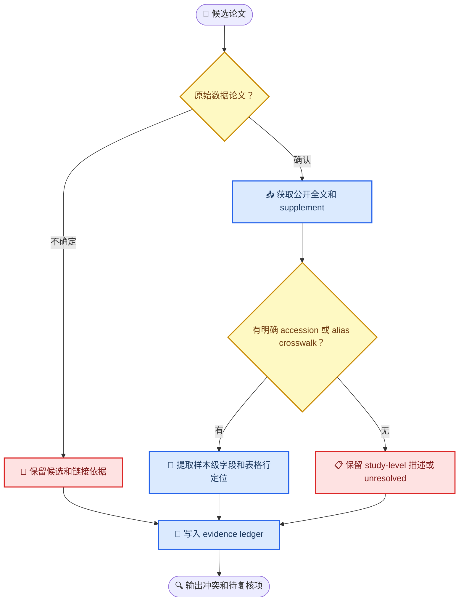

# 项目呈现形式与虚构样本示例

_用途：展示未来 GitHub 仓库可能如何呈现、输入 accession 后可交付什么，以及工作流如何处理样本关联。所有 accession、论文、字段值均为虚构示例；未进行任何外部样本查询。_

---

## 📦 GitHub 首页可以如何呈现

### 项目一句话

> 从公开测序 accession 出发，发现 archive、论文与补充材料中的相关记录，建立可审计的样本映射，并生成带证据的本地 metadata 结果。

### 首页的三个入口

| 入口 | 使用者会找到什么 | 例子 |
|---|---|---|
| **Data resources** | 可查找/下载菌群测序数据、样本 metadata 或分析结果的数据库和平台 | NCBI SRA、ENA、MGnify、Qiita、GMrepo、Microbiome Repo |
| **Tools** | API 客户端、accession 查询器、下载器、ontology mapper、论文/表格解析器 | `pysradb`、`enaBrowserTools`、SRA Toolkit、PMC BioC API |
| **ID-to-evidence workflow** | 输入样本 accession，得到数据库关系、论文与补充材料线索、sample crosswalk 和本地结果文件 | 本项目未来自研流程 |

README 可放 Quick start、适用范围、输入/输出示意、资源目录入口、工具目录入口、贡献规范和已知限制。资源清单应该能让开发者快速比较 API、sample unit、许可、数据更新状态和 metadata 覆盖。

### 一个资源目录条目的样子

| 属性 | 示例内容（MGnify） |
|---|---|
| 类型 | 微生物组数据/分析平台与 REST API |
| 主要对象 | Study、Sample、Run、Analysis |
| 覆盖 | ENA 关联的宏基因组、宏转录组、扩增子及组装数据 |
| 能做什么 | 查询项目、样本和分析结果；查看由 ENA/BioSamples 等来源提供的信息 |
| 可关注的增强信息 | 部分论文的 Europe PMC/EMERALD 文本挖掘 annotation |
| 限制 | 论文 annotation 不等于某一个样本的 annotation；MGnify 文档指出，无法自动且有把握地判定其对应哪些具体样本[^1] |
| 目录状态 | 保存官方链接、API 文档、最近核查日期、license/访问条件和示例请求 |

这让使用者知道 MGnify 是值得查询的资源，也能避免把文章层面的 annotation 错当成样本级证据。Qiita 也可以有独立条目，说明它提供 study、sample 和 preparation metadata，同时注明具体 API 的访问/认证条件。[^2]

### 一个工具目录条目的样子

| 工具 | 类别 | 输入/输出 | 主要用途 | 应标明的限制 |
|---|---|---|---|---|
| `pysradb` | SRA/ENA/GEO metadata 查询客户端 | project/sample/run accession → metadata 表 | 快速展开 archive 层关系与字段 | 输出仍取决于 archive 已提交的 metadata |
| `enaBrowserTools` | ENA 查询/数据获取命令行工具 | ENA accession → record 或数据文件 | 获取 ENA records/read files | 主要解决 archive/data access，不负责恢复作者论文表里的 host 字段 |
| SRA Toolkit | 序列数据下载/转换工具 | Run accession → SRA/FASTQ 等数据 | 取回和转换 sequencing reads | 不属于宿主信息抽取器 |
| PMC BioC supplementary API | 文献附件/文本获取 API | PMID/PMCID → 可用 supplement 列表或文本内容 | 为论文与补充材料解析提供入口 | 覆盖范围取决于 PMC OA 子集和文件可解析性 |

工具目录的目标是“帮助选工具并给出可靠用法”，不把下载、analysis、metadata normalization 和论文内容抽取混成一种能力。NCBI 也把 SRA 记录拆成 Study、Sample、Experiment 和 Run；Run 和 Experiment 带有 sequencing/library 技术信息。[^3]

## 🧪 一个虚构的输入到结果例子

假设用户只提交一个 Run ID：`DEMO_RUN_001`。这个 ID 是虚构占位符，不能用于真实查询。

流程可能发现：

1. archive 记录把 Run 连到 Experiment、BioSample 和 BioProject；
2. BioProject 页面声明了一篇论文，Europe PMC 又从正文或 data-availability 部分发现相同 project/accession；
3. 论文 supplement 表格用作者内部样本名 `S-014`；另一张 crosswalk 表将 `S-014` 连到这个 BioSample；
4. supplement 的 participant row 提供了部分 host fields；正文描述研究总体样本来源和 protocol；
5. 工具分别记录“已证实的样本级值”“研究级描述”和“在已检查来源中未找到的字段”。

### 最终本地输出包

| 文件 | 内容 | 虚构示例 |
|---|---|---|
| `input_manifest.csv` | 原始输入与解析状态 | `DEMO_RUN_001, detected_as=Run, status=matched` |
| `accession_graph.csv` | Study/BioProject、BioSample、Experiment、Run 之间的关系 | `DEMO_RUN_001 → DEMO_EXP_001 → DEMO_BIOSAMPLE_001 → DEMO_PROJECT_001` |
| `publication_links.tsv` | 文献 ID、链接来源和论文角色 | `doi:10.0000/demo-paper, relation=own_data, link_method=BioProject_publication` |
| `sample_crosswalk.tsv` | archive ID、作者 sample alias、subject/visit 的连接证据 | `DEMO_BIOSAMPLE_001 ↔ S-014, match=explicit_supplement_crosswalk` |
| `metadata_claims.csv` | 一行一个字段证据，包括 raw/normalized value、scope、locator、quote 和状态 | 年龄、性别、study-wide body site 等分行保存 |
| `sample_master.csv` | 方便后续分析的一行一个 BioSample 汇总视图 | 每列可追溯回 claim ID；Run IDs 放独立关系字段或关联表 |
| `conflicts_unmatched.csv` | 来源冲突、supplement 未匹配行、待审核映射 | 不把冲突来源强行合成一个“正确”值 |
| `retrieval_manifest.json` | API/source、检索时间、release、文件校验值和运行状态 | 方便复跑与审计 |
| `QC_summary.md` | 匹配率、字段覆盖率、失败/不可访问情况 | 例如“1 个输入 ID；1 篇原始数据论文；2/3 个补充文件可解析” |

### metadata claim 的虚构行示例

以下只展示将来表格形式，不表示真实 accession 或真实研究结果。

| sample_key | field | raw_value | normalized_value | scope | source_locator | match_method | status |
|---|---|---|---|---|---|---|---|
| `DEMO_BIOSAMPLE_001` | age | `42 years` | `42 year` | subject/sample | `Supp_Table_2.xlsx / Sheet1 / row 14` | `explicit alias crosswalk: S-014` | `validated` |
| `DEMO_BIOSAMPLE_001` | sex | `female` | `female` | subject/sample | `Supp_Table_2.xlsx / Sheet1 / row 14` | `explicit alias crosswalk: S-014` | `validated` |
| `DEMO_BIOSAMPLE_001` | diet | *(empty)* | *(empty)* | sample | `paper + checked supplements` | n/a | `not_found_in_checked_sources` |
| `DEMO_BIOSAMPLE_001` | country | `participants recruited in Demo City` | `Demo Country` | study/cohort | `Methods / Study population` | `cohort-level statement` | `study_scope_only` |

如果 archive 和 supplement 对年龄给出不一致值，两个 claim 都会保留并进入 conflict 表；如果 supplement 只写了 cohort 共同描述，则只以 `study/cohort` scope 输出。最终宽表不应抹去这些来源和粒度信息。

## 🔄 ID 到本地结果：流程总览

```mermaid
flowchart LR
    accTitle: ID 到本地结果
    accDescr: 从样本 ID 解析 archive 关系，寻找关联论文并验证 crosswalk，最后生成有来源记录的本地结果包。

    resource_catalog[📚 资源目录] --> connectors[🔌 数据源连接器]
    input_ids([📥 输入样本 ID]) --> id_resolver[🔍 识别 ID 并解析]
    connectors --> id_resolver
    id_resolver --> archive_graph[🔗 建立 BioSample、Experiment、Run、Study 关系]
    archive_graph --> paper_search[📚 发现关联论文和 supplement]
    archive_graph --> archive_claims[🗂️ 保存 archive 属性和技术字段]
    paper_search --> crosswalk[🔎 验证作者 ID 与 accession 映射]
    crosswalk --> evidence_ledger[📑 记录字段值、scope、来源和证据]
    archive_claims --> evidence_ledger
    evidence_ledger --> quality_check[⚙️ 检查缺失、冲突和未匹配项]
    quality_check --> local_outputs([📤 本地结果包和 QC 摘要])

    classDef process fill:#dbeafe,stroke:#2563eb,stroke-width:2px,color:#1e3a5f
    classDef success fill:#dcfce7,stroke:#16a34a,stroke-width:2px,color:#14532d
    class id_resolver,archive_graph,paper_search,crosswalk,archive_claims,evidence_ledger,quality_check process
    class input_ids,local_outputs success
```

## 🧾 论文和补充材料如何映射到样本

## ✅ 分阶段后可实现的任务

| 阶段 | 用户可实际完成的事 | 可验收的结果 |
|---|---|---|
| **MVP-A：资源/工具目录** | 查到菌群数据资源、它们提供什么数据、如何访问、有哪些限制 | 可浏览的 GitHub README + 结构化目录文件 + 使用示例 |
| **MVP-B：输入 ID 解析** | 给一个 Run/BioSample/Project ID，取回其 archive accession graph 与技术 metadata | 本地 `accession_graph.csv`、sample/experiment/run 表和解析状态 |
| **MVP-C：论文与 supplement 发现** | 看到关联论文、论文和项目的关系、可获取的公开附件 | `publication_links.tsv`、supplement 清单、访问状态 |
| **MVP-D：样本映射与证据化 metadata** | 对精确 crosswalk 的样本取出年龄/性别/健康/采样等字段并追溯出处 | `sample_crosswalk.tsv`、`metadata_claims.csv`、冲突和未映射报告 |
| **MVP-E：质量评估** | 知道多少 ID 找到了关联研究、多少字段有样本级证据、常见失败在哪 | QC 摘要、人工审核记录和可复跑 manifest |

首版不需要中央数据库。用户运行时生成带版本、检索日期和来源记录的本地结果；以后若社区确实需要共享的查询服务，再讨论如何发布已复核的 curated releases。

## 📌 本轮边界

本示例、输出 schema 和流程图均为设计展示，没有查询真实 ID，没有生成真实 metadata，也没有编写或运行数据检索程序。

[^1]: MGnify. “Website and portal: Viewing metadata for MGnify Samples, Studies, Publications.” https://docs.mgnify.org/src/docs/portal.html
[^2]: Qiita Documentation. “Welcome to Qiita’s documentation.” https://qiita.microbio.me/static/doc/html/index.html
[^3]: NCBI. “SRA Metadata and Submission Overview.” https://www.ncbi.nlm.nih.gov/sra/docs/submitmeta/
